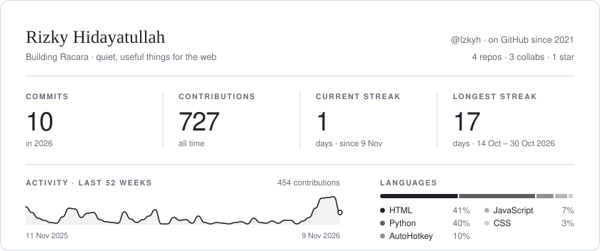

  <picture>
    <source media="(prefers-color-scheme: dark)" srcset="./assets/stats-dark.svg">
    
  </picture>
    
  

    <a href="https://izkyh.vercel.app">Website</a> &nbsp;·&nbsp;
    <a href="https://www.linkedin.com/in/rizky-hidayatullah-a65247439/">LinkedIn</a> &nbsp;·&nbsp;
    <a href="mailto:eizkyh@gmail.com">Email</a>
  

